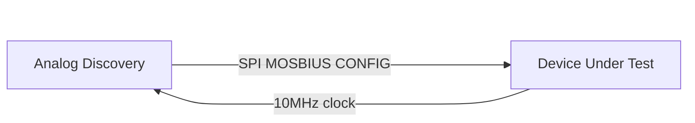
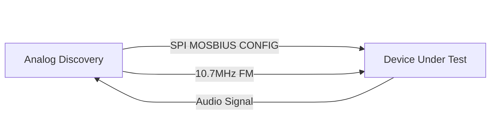

# C4 Super Long wave - General purpose PLL - Test plan
## Functional test

### SPI configurable VCO
Testing VCO function.
Device will be configured by SPI MOSBIUS CONFIG data.
Output 10MHz signal.

### FM demodulation by PLL
Testing FM demodulation function.
Device will be configured by SPI MOSBIUS CONFIG data.
Input FM intermidiate frequnecy 10.7MH Wideband FM modulation signal,
Output Audio Signal.

